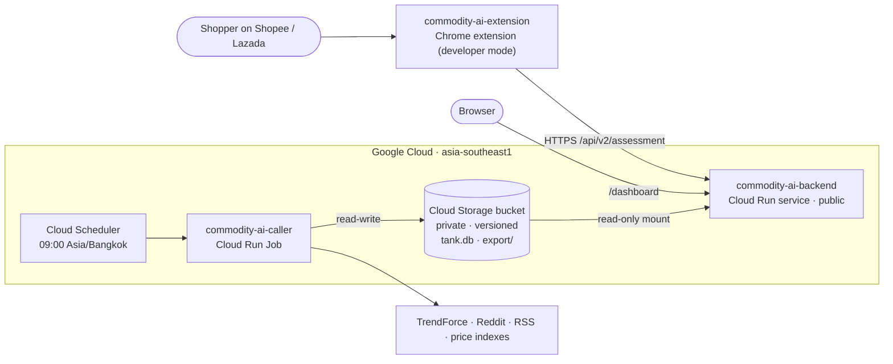

# Commodity AI — caller (daily data refresh)

The data side of Commodity AI. Once a day this job collects prices and text about memory, storage and GPUs, keeps them
in a SQLite "tank", rebuilds the features and the assessment snapshot, checks them, and publishes the export that
[commodity-ai-backend](https://github.com/MobyDIGG-commidtyAI/commodity-ai-backend) serves.

## Architecture



## What it collects

| Kind | Sources (`scripts/run_*.py`, `src/cai/`) |
|---|---|
| Prices | TrendForce DRAM/NAND spot, MemRadar US retail price index, GpuPrix, r/buildapcsales deal posts, Yahoo Finance, Wikipedia pageviews, cloud GPU prices |
| Text | TrendForce news, RSS (trade press, Google News), Reddit posts and comments, Hacker News; each row tagged `social_network`, `industry_news` or `general_news` (`config/genres.yaml`) |

Free, no-approval sources only. Some sites rate-limit or block cloud IPs; collectors are tolerant and the rebuild still runs.

## One refresh run (`scripts/cloud_job.sh`)

1. Copy `tank.db`, cursors and the current export from the bucket mount (`DATA_MOUNT`) to local disk (SQLite never runs on gcsfuse).
2. Run `scripts/daily_cron.sh`: collectors, then deal prices, genre tags, dedup, features, exports, assessment snapshot.
3. Save `tank.db` back after `integrity_check`.
4. Publish `export/` only if `scripts/check_export.py` passes; otherwise the API keeps serving the last good data.
5. Exit 3 means "published, but a collector failed" and raises the job-failed alert.

Bucket layout: `tank.db`, `raw/` (cursors), `export/` (what the API reads), `partner/` (a teammate's archive, read only).

## Run locally

```bash
conda create --yes --prefix ./.conda/codex/dev python=3.12
source "$(conda info --base)/etc/profile.d/conda.sh" && conda activate ./.conda/codex/dev
UV_PROJECT_ENVIRONMENT="$CONDA_PREFIX" "$(conda info --base)/bin/uv" sync --frozen --inexact
scripts/daily_cron.sh          # updates data/tank.db and data/export/ (last 21 days of sources)
```

For full history, start from a copy of the team's tank (`deploy/gcp.sh seed` uses the same files) or run the
backfill collectors in `scripts/run_*.py`.

## Test

```bash
python -m pytest -q
shellcheck -S warning scripts/*.sh deploy/*.sh
```

## Deploy (Google Cloud)

```bash
PROJECT=<gcp-project> DATA_REPO=../commodity-ai-data deploy/gcp.sh all   # setup, seed the bucket, build, job + scheduler, alert, one run
PROJECT=<gcp-project> deploy/gcp.sh build deploy
```

`seed` copies the existing tank, export and partner archive from the team's private data checkout (`DATA_REPO`) into the
private bucket once; after that the job keeps them current. The job runs as `cai-refresh` (bucket write); the scheduler as
`cai-scheduler` (may only start this job). If collectors are blocked from GCP IPs, set `HTTPS_PROXY_SECRET`.

## Troubleshooting

- **Job exit 3**: exports were published but a collector failed, usually because a site blocks GCP IPs. Check the job logs;
  if it repeats, put a proxy URL in Secret Manager and redeploy with `HTTPS_PROXY_SECRET=<secret-name>`.
- **Other non-zero exit**: the rebuild or the export check failed; the API keeps serving the previous export.
- **API still shows the old `dataset_version` after a run**: the service sees the bucket through gcsfuse's metadata cache.
  Add `mount-options=metadata-cache-ttl-secs=60` to the backend's volume.
- **No `tank.db` in the bucket**: run `deploy/gcp.sh seed` with `DATA_REPO` pointing at the private data checkout.

## License

MIT
